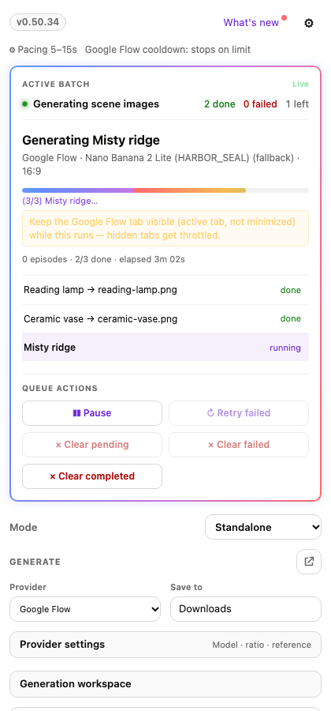
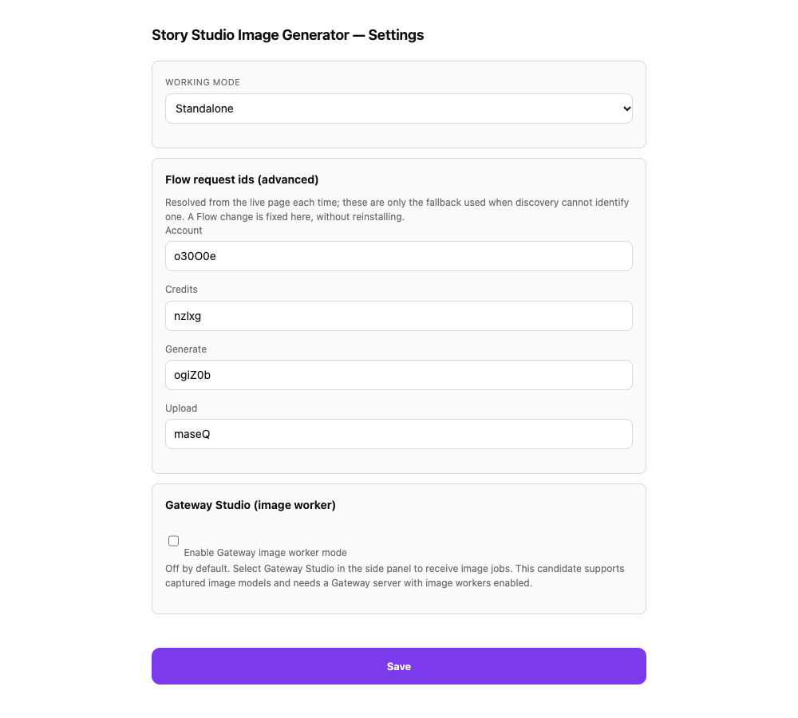

#  Story Studio Image Generator

A Chrome extension that generates images from prompts with a signed-in web
provider and saves them to Downloads. It can also work as a Gateway Studio
image worker.

The panel shows the active batch, each scene's progress and the queue controls. A dark theme is
carried too: [panel-dark.png](docs/screenshots/panel-dark.png).

Settings carries the real choices — working mode and the Gateway worker switch:
[dark version](docs/screenshots/settings-dark.png).

Screenshots are captured from the build being released, in a throwaway profile with demo content.

## What it does

- Runs pasted prompts through a persistent queue with progress, pause, retry and recovery.
- Saves each finished image to Downloads.
- Uses the signed-in web session of one of five image providers.
- Can also claim image jobs from a Gateway Studio server (see below).

## Workflow

1. Open the side panel. Standalone is the default mode.
2. Paste one image prompt per line, review the split, and queue it.
3. Watch the active batch view; each finished image is saved to Downloads.
4. Switch to Gateway Studio to claim jobs from a configured Gateway server.

Maintained image providers: Google Flow, Google AI Studio, Qwen Studio, Leonardo
AI and ChatGPT. The registry ships with the extension, so a removed provider
never receives new work or retries.

- Gateway jobs may carry up to four reference images for Flow. The queue stores
  the staged bytes in IndexedDB, never in queue storage.
- Standalone prompts carry no references. Leonardo references stay page-managed.

## Model identity

Queued work snapshots the model identity and generation settings it was queued
with, so batch diagnostics show what actually ran. AI Studio, Qwen and ChatGPT
are website-controlled; Leonardo is discovered live from its signed-in page.
Unknown or changed selections fail before submission and need a refresh and
re-queue.

Flow's catalogue carries the two labels its picker shows — "Nano Banana 2.1"
(key `BELUGA`) and "Nano Banana 2 Lite" (key `HARBOR_SEAL`). A bundled record
counts as live only while the signed-in page shows its exact label as a line of
its own; a closed picker, a signed-out tab or an unlabelled page leaves both as
manual fallback choices and claims nothing. A label the picker no longer shows is
never fuzzy-matched.

New provider integrations and most new provider models need an extension update,
so a model you can see in Flow may not be in the picker here yet.

## Gateway Studio worker (second mode)

Mode → **Gateway Studio**, then fill the Gateway address, worker token and worker
ID in the side panel (or Settings). Off by default. One job at a time, same queue and pacing as manual
work, 30-second claim alarm plus a **Claim now** button.

Wire, all outbound from the extension — it opens no port and holds no inbound
listener:

- `GET /api/workers/health` → `{ok, workerId, kind:'image', maxResultBytes, control}`.
- `POST /api/workers/telemetry` `{workerId, kind:'image', telemetry}` → `{ok, control}`. `telemetry.state` reports actual activity, enabled/paused, applied `controlRevision`, observed timestamp, current pacing and `nextEligibleAt` (null when paused or held). Connection and sign-in stay unknown on a tick that is not claiming.
- `POST /api/workers/claim` adds `account` and `quote`; `POST /api/workers/jobs/{id}/progress|result|fail`.

Account and quote:

- The account is the opaque Flow identity and remaining credits (`o30O0e`,
  `nzlxg`) read from the signed-in page in that same request. Nothing is derived
  from a profile, cookie or email, and the account block repeats `telemetry.state`
  exactly.
- Executable claims need a fresh observation of that same account in that same
  request, a matching quote, and the current control revision. A cached
  observation or a server-returned account binding cannot replace them.
- Flow images are **free**: an unset price quotes 0 credits, and 0 is a real
  price, never "unknown". The Settings field only overrides it, and both screens
  say so. Nothing is read from the page: Flow shows no credits line and the
  balance did not move across generated images (50/50, then 30/30). A zero
  balance never refuses a free job.
- `quoteRequired` is an unclaimed, read-only preview, never a generation request.

Safety: a job is held rather than replayed. An unexpected executable offer, an
unknown outcome, or a claim we did not quote ourselves is retained for review;
generated bytes stay in IndexedDB and can be delivered again without generating.
Legacy pending Gateway work is retained too. Gateway schema-1 controls are
persisted as a connection-bound stop before any pacing is applied, an invalid or
unknown control stops dispatch without acknowledging a revision, and local Resume
cannot override the manager stop. A close request never kills Chrome, erases a
hold or clears an unknown outcome — Gateway alone decides safe closure from fresh
exact-revision paused state.

Worker IDs and tokens identify a connection, not a Chrome profile, provider
account or shared credit pool. Relay owns shared browser/account mapping,
enablement and scheduling. No balance, allowance, reset timezone or per-worker
duplicate balance is inferred. Browser TTS is outside this extension and stays
optional/off in Relay.

## Parity gaps, stated plainly

- Gateway Image maps the observed keys above, the two ratios with a real submit
  behind them (16:9 sends 3, 9:16 sends 2), counts of 1, 2 or 4, up to four
  references and the Flow project ID. 4:3, 1:1, 3:4 and `size` have no observed
  submit value and are refused at claim rather than guessed. The count slot is
  unproven: the capture carried `null` there with a count of 1.
- No claim has run end to end yet. Gateway's code accepts a 0-valued quote
  (`store.py` `_acc_quote`; its over-quote check is `0 > 0` at a zero balance), so
  if a first live claim fails, check the worker token's `dispatch_enabled`, the
  account's `profile_enabled`/`gateway_enabled`, activity outside
  `{idle, waiting}`, a null or future `next_eligible_at`, or an older held
  reservation — before blaming price.

A known model, an observed control, an authenticated current listing, a supported
request schema and verified generation are five separate facts. Source and
offline fixtures prove none of the others.

## Install

1. Open `chrome://extensions` and enable **Developer mode**.
2. **Load unpacked** → select this repository folder.
3. Open the extension from the toolbar to use the side panel.

There is no build step. The queue survives closing and reopening the side panel.
